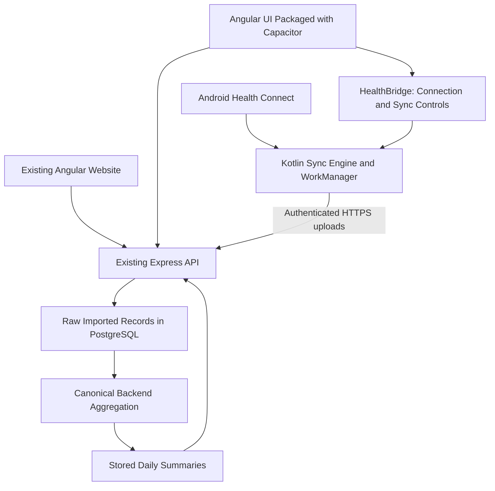

# LifeTrack Android App Plan

Status: Foreground sync validated on the Pixel 6a emulator; background/device gates and the full Android product remain incomplete (audited 2026-10-07).

## 1. Goal

Provide one LifeTrack Android app for everyday finance and health tracking while
keeping the existing web application available for all users.

- Reuse the existing Angular screens, services, Express APIs, and PostgreSQL database.
- Adapt the experience for a phone instead of presenting an unchanged desktop layout.
- Integrate the existing Kotlin Health Connect sync engine into the full Android app.
- Use one account across web and Android; do not create a second finance database.
- Keep finance calculations and health scoring separate.
- Keep health permissions and data sharing optional.

## 2. Current Baseline

| Area | Existing implementation |
| --- | --- |
| Web | Angular 19, Angular Material, Tailwind, shared ECharts components |
| Backend | Express/TypeScript, JWT authentication, Prisma/PostgreSQL |
| Finance | Expenses, income, investments, banks, cards, budgets, goals, reports, tax and other modules |
| Health | Manual tracker plus imported-data summaries, trends and sync controls |
| Android companion | Kotlin app under `android-companion/`; debug APK built |
| Capacitor spike | Separate `frontend/android/` debug app; Keystore-backed sessions, selective permissions, connection lifecycle and WorkManager sync |
| Health import MVP | Steps, sleep, exercise, weight and average heart rate |
| Background sync | Feature-checked Health Connect background reads, change tokens and six-hour WorkManager scheduling |
| Sync persistence | Separate connection, imported-record, daily-summary and batch-receipt models |

The standalone companion remains a health connector, not the full LifeTrack Android app.
Capacitor 7.4.3 is pinned in the frontend. Its sync engine source is now shared into the
Capacitor app build; the standalone companion APK remains separately buildable.

## Current Status Audit - 2026-10-09

| Phase / gate | Status | Evidence / remaining work |
| --- | --- | --- |
| Phase 0: Health Connect validation | **Foreground/background/process-death/reboot pass (emulator)** | Pixel 6a emulator imported 1,234 Steps, observed an update to 2,345, then deletion back to zero through foreground sync. Backgrounded WorkManager sync, process-death recovery, and five independent reboot recoveries have since passed (see Phase 2/Proof 5). No physical phone is connected. |
| Phase 1: Capacitor proof of concept | **Implemented; foreground proof** | Latest packaged Angular APK completed the Health connection and foreground sync flow on Pixel 6a. Mobile-first UX and background proof remain open. |
| Phase 2: auth and native bridge | **Implemented; foreground/backgrounded/process-death/reboot emulator pass** | Keystore-only refresh storage, selective permissions, backend connection lifecycle, foreground Changes API sync, backgrounded WorkManager sync, process-death recovery and five independent reboot-triggered WorkManager runs passed on emulator. Strict UI/worker refresh overlap now passes; repeated cold-boot/unattended runs and physical-device observation remain open. |
| Proof 1: Angular packaged app runs | **Pass (latest APK)** | Temporary-account sign-in and packaged Health route rendered; native Keystore refresh storage was verified without a WebView localStorage refresh token. |
| Proof 2: login/refresh and UI/worker coordination | **Partial** | Angular auth/session tests passed 9/9 on 2026-10-08, including logout racing a stale refresh response. Emulator `--refresh-race`, `--strict-refresh-race`, `--logout-race`, and `--account-switch-race` smokes passed. Strict overlap held the WorkManager refresh response, confirmed the UI refresh stayed queued, then verified both requests succeeded and the UI used the rotated token. The account-switch run held user A's WorkManager refresh, performed navbar logout, started user B login before releasing the stale request, then verified the backend returned 401 and user B's exact refresh token remained in Keystore with Health disconnected. Android `SessionRefreshCoordinatorTest` passed 2/2. |
| Proof 3: restricted native bridge | **Foreground record pass** | The app created an authenticated connection and synced insert/update/deletion changes through the control/status bridge; Angular did not receive health records or credentials. |
| Proof 4: selected/partial permissions | **Pass on emulator** | Only Steps was granted and synced; Sleep, Exercise, Weight, Heart Rate and background read remained ungranted. Explicit denial and OS/device variants remain. |
| Proof 5: WorkManager sync while app is closed | **Process-death and reboot recovery pass (emulator); long-run gate open** | With networking disabled, LifeTrack was killed before sync success; after network restoration WorkManager completed and the app restored its session/connection. A boot receiver now re-enqueues the existing unique work when background sync was requested; five independent reboot runs completed sync and restored the session/connection without manually opening LifeTrack. Repeated cold-boot/unattended runs and physical-device observation remain open. |
| Phase 3: mobile-first UX | **Core navigation pass; Expenses, Income, Banks, Cards, Goals, Investments and Transactions phone views implemented** | Latest-APK emulator smoke passed packaged sign-in/Keystore storage, Home/Finance/Health/More navigation, and all Finance list routes without overflow. A separate disposable-account smoke completed Goal and Investment create/edit/delete through mobile cards and verified 44px edit targets. Browser checks cover seeded rows and search/selection. Physical-phone sizing and broader data-bearing workflows remain open. |
| Phase 4: Finance MVP | **Core workflows complete; packaged Android emulator smoke pass** | The latest disposable-account APK smoke passed Expenses CRUD/category filtering/receipt attachment, Dashboard recent activity, Income CRUD, bank balance create/update/delete, credit-card statement and partial-payment details, Goal contribution and CRUD, Investment CRUD, current-month budget setup/review, and Notifications/Profile/Settings navigation. Finance routes passed the phone overflow checks. Physical-phone validation remains open under Phase 3 follow-through. |
| Phase 5: health production integration | **In progress; backend canonical aggregation and emulator source-selection smoke pass** | The backend now derives versioned summaries from retained raw records and manual entries, supports one selected Health Connect app per metric, records per-day provenance, and stores device aggregates only as parity references. Database migration, Health API/UI integration, redacted request logging, focused tests, packaged APK build, and the disposable-account emulator source-selection smoke pass. Physical-device unattended sync, broader overlapping-source parity, and release gates remain open. |
| Phase 6: broader coverage | **In progress; FD portfolio and Mutual Funds phone slices pass** | Packaged emulator smoke passes FD portfolio navigation plus create/edit/delete, and Mutual Funds navigation, holding summary cards, scheme detail, and transaction cards without overflow. Reports, tax, analytics/export, advanced FD workflows and remaining broader features are still web-first. |
| Phase 7: production release | **Not started** | No release signing, Play review, production native API origin, privacy submission or release audit. |

### Current Blockers

1. **Background gate:** Normal backgrounded sync, one process-death recovery and five reboot-triggered recoveries pass on emulator. A private boot receiver checks persisted background-request/connection state and re-enqueues the existing unique work. `--refresh-race`, `--strict-refresh-race`, `--logout-race`, and `--account-switch-race` passed; the deterministic coordinator test passed 2/2. Worker token and failure-state writes are guarded against a changed server/connection/generation, and cancellation propagates correctly. Repeated cold boots/unattended runs and physical-device observation remain open. Android does not guarantee an exact schedule.
2. **Production API origin — scaffolding added 2026-10-09, domain pending.** Added `environment.android-production.ts`, an `android-production` Angular build configuration, `build:android-production`/`sync:android-production` scripts, and made `capacitor.config.ts` select the matching `webDir` so production assets sync instead of the spike build's. Both production build and sync were verified end-to-end; spike assets were restored afterward. The environment file's API URL remains `https://REPLACE_WITH_PRODUCTION_DOMAIN/api/v1` because no deployed production origin is confirmed. Replace it with the trusted HTTPS backend URL before building; release signing (Phase 7) is still not started, so no production APK task was added.
3. **Google sign-in:** native Credential Manager integration is now present in the Capacitor app (`@capgo/capacitor-social-login` with the Android web client ID). The button-render/tap smoke exists, but successful account selection and backend token exchange still need verification on a configured Android device; the production web environment remains separate.
4. **Health production gate:** backend-owned canonical summaries, raw sleep stages/zone offsets, heart-rate samples, manual overrides, source selection and provenance are implemented. Native aggregates remain parity references. Physical-device unattended sync, broader source-overlap fixtures and operational parity review remain open.
5. **Backend typecheck — resolved 2026-10-08.** The backend build now passes after narrowing restored expense IDs, importing Nodemailer's `Transporter` type, and pinning CommonJS-compatible otplib 12.0.1. Focused TOTP tests cover code verification and enrollment URI/QR generation. The v12 adapter packages are deprecated upstream; choose a maintained TOTP/runtime combination before production.

### Next Execution Plan

1. **Background gate.** Run additional cold boots and an unattended physical-device observation when a phone is available. The emulator has five successful reboot-triggered runs, strict UI/worker refresh overlap, and active-worker logout/account-switch invalidation; long-run and physical-device evidence remain open. Android does not guarantee an exact schedule.
2. **Phase 3 follow-through.** Review long labels, keyboard behavior, safe areas and desktop regression on physical phone sizes. Latest-APK emulator checks cover every Finance list, and a disposable-account smoke covers Goal/Investment CRUD; emulator viewport checks are not physical-device validation. Keep unvalidated/advanced routes hidden.
3. **Phase 5 follow-through.** Validate the selected-source policy against overlapping real Health Connect apps and manual edits on a physical phone; complete unattended network/reboot/revocation tests and confirm historical reference behavior before closing the production gate.

### Emulator Spike Results - 2026-10-05

- The debug APK installed and rendered packaged Angular assets on the Pixel 6a API 37 emulator.
- Dashboard, Health and Settings navigation and in-session refresh were checked.
- Angular displayed real Kotlin bridge status: Health Connect available, background-read
    capability available, background permission not granted, and connection disconnected.
- At the initial checkpoint the bridge implemented only status reads. The Phase 2
    session/permission results below supersede that initial limitation.
- The initial checkpoint used memory-only Android refresh tokens; Phase 2 adds
    encrypted native persistence without WebView localStorage credentials.
- Native routes/sidebar entries are restricted to the core spike workflows; browser routes remain unchanged.
- Native Angular build, debug APK build, browser regression build and two development/production
    CORS checks passed. The native status panel was checked at the emulator's phone viewport.
- Debug API URL is `http://10.0.2.2:4000/api/v1`; it is emulator-only, not a release configuration.
- The spike uses Gradle 8.13, Android Gradle plugin 8.13.0, Kotlin 2.1.20 and a portable
    Java 21 runtime. The companion retains its separate toolchain; Node/Angular were not upgraded.

Commands from the workspace root:

```powershell
npm.cmd --prefix frontend run prepare:android-jdk
npm.cmd --prefix frontend run sync:android-spike
npm.cmd --prefix frontend run apk:android-spike
```

The portable Java setup is Windows-specific and does not replace global Java settings.
The APK is `frontend/android/app/build/outputs/apk/debug/app-debug.apk`.
The five-proof gate remains open: the Capacitor worker is implemented, but its integrated
record-upload path has not been verified on a live emulator/phone. Emulator results do not
replace physical-phone or unattended-background-sync evidence.

### Phase 2 Session and Permission Results - 2026-10-05

- Android refresh credentials are encrypted with AES-GCM using a non-exportable Android
    Keystore key. Access credentials remain in memory; neither is persisted in WebView localStorage.
- Startup awaits native credential loading and attempts session restoration. Demo sign-in
    and automatic restoration after a process restart were verified on the emulator.
- Credential writes are serialized and awaited before publishing an authenticated session.
    Concurrent UI refresh requests share one request. A stale refresh cannot restore a logged-out session.
- Logout clears the native vault, including when server logout is unavailable. Offline local
    logout does not guarantee server-side revocation; that limitation remains distinct.
- Native bridge payload logging is disabled. HealthBridge does not return credentials or records.
- The permission UI requests only explicitly selected supported metrics after consent.
    Background-read permission is separately selected and checked for feature availability.
- The bridge now supports `requestPermissions()` and a narrow platform-settings action,
    alongside its status methods. Android settings allow permission management/revocation.
- Steps and Sleep were selected in the emulator. Only Steps was granted; the callback
    reported a partial grant correctly. The test Steps grant was subsequently revoked,
    and status returned to an empty grant set. No health records were imported.
- Nine Angular session/storage tests, three focused Kotlin permission-policy tests, native
    APK packaging and the normal browser build passed. Logout vault cleanup was verified.
- Backend-backed connection creation and disconnect were added after the earlier status/permission
    checks: the Angular client creates the authenticated `HealthConnection`, then gives only its ID,
    generation and selected metric names to the native plugin. Kotlin requires a UUID, nonnegative
    generation, unique supported metrics and at least one granted selected metric before storing it.
- Native preferences hold the local connection ID, generation and enabled metric set. The status
    bridge reports `CONNECTED` separately from execution state; connection alone never means synced.
    Connect/Disconnect invalidates both backend and local state. The browser still uses its existing
    backend connection controls.
- The Android sync-queue button stays hidden on the web because the web cannot wake the phone;
    Android exposes manual Sync Now and unique periodic WorkManager work.
- The Capacitor app compiles the companion's Health Connect Changes API engine and a dedicated
    Capacitor WorkManager worker. They share a serialized Keystore-backed refresh-token coordinator
    with foreground auth; native connection changes are also picked up by the sync engine.
    Manual sync runs foreground when background-read access is absent; when background was explicitly
    requested and granted, it queues unique network-constrained WorkManager work. Periodic work is
    scheduled at a six-hour interval, subject to Android scheduling/battery limits.
- The worker uses per-metric change tokens, paginated upserts/deletions, pending idempotent batches,
    bounded 29-day reconciliation after token expiry, local-day dirty tracking, retry status and
    startup/session generation checks. No exact execution time is promised.
- MVP limitation: the current worker still uploads Health Connect-derived daily aggregates in addition
    to normalized detail records. Backend canonical aggregation/provenance and raw-sample contract
    migration are not implemented yet; treat summaries as MVP behavior, not the final single-source-
    of-truth architecture. Heart-rate samples are currently collapsed to an average in the record DTO,
    and sleep stage detail is not retained. Complete Phase 5's contract migration before production.
- Backend PostgreSQL smoke tests passed for connection creation, idempotent ingestion, ownership,
    updates/deletions, manual request and imported-data deletion. Angular native build, APK build and
    nine session/storage tests passed after the connection lifecycle changes.
- Added session cleanup on logout: disconnect the backend connection while the current authenticated
    session is still available, then clear native connection state and the Keystore vault. Expired or
    invalidated sessions always clear local connection state; backend cleanup may need retry if offline.
- After the logout cleanup change, the Android UI build and APK build passed, nine Angular session
    tests passed, and the PostgreSQL health lifecycle smoke test passed again.
- After worker integration, the final Angular spike build/sync, Capacitor APK build, nine Angular session
    tests, three Android permission-policy tests, normal browser build and backend PostgreSQL smoke test
    passed. The compiled output contains `HealthSyncEngine` and `CapacitorHealthSyncWorker`.
- The emulator became ADB-offline before connection-API/worker verification. Connection create/disconnect
    is backend smoke-tested and worker code is compiled, but no real Health Connect record upload or
    scheduled execution has been verified against a device in this latest integration. Earlier emulator
    permission grant/revocation and Keystore session restart checks passed before the outage.
- The current shared UI/worker `SessionVaultStore` coordinator compiled and its related Angular tests
    passed, but its refresh-token rotation under concurrent UI + WorkManager execution has not yet been
    exercised on-device. Do not treat the earlier app-restart check of the prior vault implementation
    as proof of this new shared coordinator.
- 2026-10-07 continuation: imported companion sources are included in the Capacitor Android build;
    `CapacitorHealthSyncWorker` now uses network-constrained, unique WorkManager periodic/manual jobs,
    the shared serialized Keystore refresh coordinator, and the existing Changes API sync engine.
    Sync status reports success/error/count fields, and manual sync runs foreground when background
    access is not enabled. Six-hour scheduling is best effort, not an exact daily promise.
- Capacitor Angular assets, APK packaging, session tests, Android permission-policy tests, backend
    PostgreSQL smoke tests and browser build passed after worker integration. The Android device
    transport was offline during the latest worker validation, so no record upload, retry or
    unattended scheduled run has been demonstrated from the Capacitor app yet.
- Native Google Sign-In UI/plugin integration is implemented; successful account selection and backend token exchange remain unverified. Physical-phone tests and the 48-hour unattended-sync gate remain pending.

### Latest Emulator Foreground Sync - 2026-10-07

- Recovered the existing Pixel 6a API 37 emulator without wiping its AVD data; ADB reports
    `emulator-5554 device`. The local PostgreSQL service and backend API were available for the run.
- `frontend/scripts/smoke-capacitor-health.cjs` passed temporary-account sign-in, Keystore refresh
    storage with no WebView localStorage refresh token, and the selective Health Connect permission
    check. Only Steps was granted; background read and the other supported metrics were not granted.
- The packaged Angular app created an authenticated backend connection and completed foreground
    Changes API sync with a Steps-only read grant. The test account and backend connection were
    removed during smoke-test cleanup.
- WorkManager unattended execution, retries, UI/worker concurrent refresh rotation and
    physical-device observation are still unverified; this result is not evidence of reliable
    background timing.

### Latest Emulator Record Lifecycle - 2026-10-07

- Added a separate debug-only Health Connect writer to the companion project. Its `WRITE_STEPS`
    permission and activity exist only in the debug manifest; the release manifest remains read-only.
- With the temporary writer permission enabled, the Pixel 6a emulator accepted a synthetic 1,234-step
    record. The existing Capacitor app, granted read access to Steps only, imported it through
    foreground Changes API sync; the authenticated backend daily summary reported 1,234.
- Updating the same Health Connect client record to 2,345 steps and syncing changed the backend daily
    summary to 2,345. Deleting that client record and syncing its Changes API deletion returned the
    backend daily total to zero. The smoke verified backend sync success and removed its temporary
    account/connection.
- The debug writer's `WRITE_STEPS` permission was revoked after the test. Synthetic data was deleted;
    no write permission was added to the packaged Capacitor app. The debug APK is only a test fixture.
- Verified the companion debug APK build and complete record-mutation smoke on the emulator. This
    proves foreground insert/update/deletion only, not WorkManager execution, retry behavior,
    physical-device behavior or canonical backend aggregation.

### Latest Emulator Background Run - 2026-10-07

- Health Connect Steps read and background-read permissions were explicitly granted to LifeTrack
    Spike on the Pixel 6a API 37 emulator. The foreground smoke app created a temporary authenticated
    connection with background access enabled, then sent LifeTrack to the Android launcher.
- Android confirmed a different resumed activity while the network-constrained
    `CapacitorHealthSyncWorker` ran. The backend reported a new successful sync timestamp and the
    expected empty daily Steps total. Disconnect cleanup completed and the temporary account was
    removed.
- Afterward, Steps read and background-read permissions were revoked; the separate debug writer's
    Steps write permission also remains revoked. This validates one backgrounded empty-data run only.
    It does not prove execution after process force-stop/reboot, retry/recovery, sync of records in the
    background, a periodic six-hour run, or reliable timing on a physical phone.

### Emulator Process-Death Recovery Attempt - 2026-10-07

- A dedicated test run registered the backend connection, held native WorkManager scheduling behind
    Android's network constraint, sent LifeTrack to the launcher, closed the WebView debugger, and
    successfully killed the LifeTrack process with `am kill` before backend success.
- Initial runs showed native `RETRYING / NETWORK` and a delayed retry beyond the original 90-second
    window. The smoke now waits up to four minutes and verifies a validated default network plus TCP
    reachability to the backend before observing the retry. In the latest run, the backend stayed
    `CONNECTED` despite the API remaining healthy and Android reporting a validated network;
    JobScheduler continued to report `CONNECTIVITY` unsatisfied. No process-death retry pass is
    claimed.
- The temporary connection was cleared, the test account removed, and Steps/background-read
    permissions revoked. Investigate WorkManager rescheduling on the emulator before repeating this
    gate; then separately test reboot and a physical phone.

### Native Sync Status Reset - 2026-10-07

- The process-death diagnostic found that a new connection generation could inherit local
    `lastSuccessfulSyncAt`, `lastAttemptedSyncAt`, record counts and retry metadata from a prior
    connection. `HealthBridge.connectHealth()` now clears per-generation checkpoints and sync status
    only when the connection ID or generation changes.
- The Capacitor debug APK rebuilt successfully. The smoke now asserts that a newly connected
    generation starts with no local success/attempt timestamp or imported count; a fresh-generation
    background sync passed with Steps-only read plus explicitly granted background access.
- The retry-after-process-kill issue remains open. Temporary Health Connect read/background grants
    were revoked again after verification.
- The debug worker logs only failure phase (`refresh` or `sync`), exception class and HTTP status;
    it does not log exception messages, credentials or health data. The diagnostic APK build and a
    normal background WorkManager sync passed. During the latest process-death test, worker logs
    showed cancellation during refresh while the network constraint was unmet; no successful sync
    after validated network restoration has been confirmed.

### Phase 3 Native Navigation Slice - 2026-10-07

- Replaced the Capacitor-only three-item sidebar presentation with a fixed Home/Finance/Health/More
    bottom bar. Finance and More open thumb-friendly destination panels; selecting a destination or
    the scrim closes the panel. The panel and bar account for Android safe-area insets.
- The web sidebar and hamburger remain unchanged. Native search is limited to the same enabled core
    routes. The Capacitor route allowlist now includes only the existing basic Finance destinations
    represented in the panel (expenses, income, transactions, banks, cards, goals and investments),
    plus dashboard, health, notifications, profile and settings; advanced/reporting routes remain
    hidden.
- `frontend/scripts/smoke-capacitor-health.cjs --ui-only` passed on the Pixel 6a emulator: temporary
    sign-in and Keystore storage, all four tabs, Finance panel to Expenses, More panel to Settings,
    direct Health navigation and the Health Body Metrics shortcut. Login, Dashboard, Settings,
    Health and Body Metrics passed a horizontal-overflow assertion at the emulator's native viewport.
    Native Dashboard hides unsupported Financial Health/Financial Level/Analytics/Reports links;
    the Health Reports shortcut is hidden while its route is not enabled. The test dismisses the
    existing onboarding tour and cleans the temporary account/session. No Health Connect
    permissions are required for this UI-only run.
- Capacitor native routing now exposes only the existing basic Finance destinations represented in
    the Finance panel and the existing Health CRUD list routes. Advanced/reporting routes stay
    filtered from the native app until separately adapted and validated; web routes remain unchanged.
- Android-targeted Angular build, Capacitor asset sync, debug APK build and focused shell tests (3/3)
    passed. This validates navigation and those route transitions, not full Finance CRUD usability,
    physical-phone behavior or all Phase 3 keyboard/safe-area cases.

### Phase 3 Expenses Phone List - 2026-10-08

- Preserved the shared desktop `app-data-table`; screens below the small breakpoint use compact
    expense rows showing category/date, amount, description, payment mode/member, recurrence/split/
    receipt indicators, and edit/delete/receipt actions. The mobile list has its own paginator tied to
    the same server-side page state and matching loading/empty states.
- Raised mobile receipt/edit/delete targets to 44px. The edit form remains the existing component and
    workflow; no expense business rules or backend calls were duplicated.
- Android-targeted Angular build, Capacitor asset sync and debug APK packaging passed. At a 390px
    browser viewport with demo data, the mobile list measured 343px, the desktop table was hidden,
    ten expense rows rendered, page scroll width stayed 390px, action targets measured 44px, and the
    edit dialog fit at 358px without horizontal overflow. This is browser responsive evidence, not
    latest-APK or physical-device confirmation; the Pixel emulator was ADB-unavailable during this
    check.

### Phase 3 Income Phone List - 2026-10-08

- Preserved the shared desktop table and added a small-screen income card list showing source/date,
    amount, description, bank account, family member and recurring status. Edit/delete remain the
    existing actions; the mobile list uses the same server-side page state and a dedicated paginator.
- Raised mobile edit/delete targets to 44px. No income calculations, write APIs or validation rules
    were changed.
- The Android-targeted Angular build passed. At a 390px browser viewport with demo rows, the mobile
    list measured 343px, the desktop table was hidden, ten income rows rendered, page scroll width
    stayed 390px, and the edit dialog fit at 358px without saving. This is browser responsive evidence;
    ADB was unavailable, so the updated APK has not been exercised on Android yet.

### Phase 3 Bank Accounts Phone List - 2026-10-08

- Preserved the shared desktop table and added a compact small-screen account card with bank name,
    account type, masked account number, balance, IFSC and last-updated date. Existing edit/delete
    actions remain; the mobile controls have 44px targets, and the reconciliation action remains in
    the page header.
- The Android-targeted Angular build passed. At 390px in the browser with three demo accounts, the
    mobile list measured 358px, the desktop table was hidden, page scroll width stayed 390px, and the
    edit dialog fit at 358px. The dialog was canceled without saving. This is not latest-APK or
    physical-device validation; ADB remained unavailable during this check.

### Phase 3 Credit Card Phone View - 2026-10-08

- Kept the existing responsive Credit Card grid. Card facts now live in an explicit detail link,
    separate from edit/delete controls, avoiding nested interactive elements and making card detail
    keyboard reachable. Edit/delete targets are 44px; long names and utilization rows can shrink/wrap.
- The Android-targeted Angular build passed. At 390px in the browser, the list had no horizontal
    overflow, the demo card rendered in a 343px column with 44px actions, and its detail route opened
    without overflow. No card or statement data was changed. ADB was unavailable, so this is browser
    responsive evidence, not a latest-APK/physical-phone pass.

### Phase 3 Goals Phone List - 2026-10-08

- Preserved the desktop table and added a small-screen goal card with name/type/deadline/status,
    saved-versus-target amount, progress bar, required monthly contribution and projected completion
    where available. Existing contribution, history, edit and delete actions remain; each has a 44px
    target. Progress values are displayed from the existing backend model; no calculations were
    duplicated.
- The Android-targeted Angular build passed. At 390px in the browser with six demo goals, the mobile
    list measured 343px, the desktop table was hidden, page scroll width stayed 390px, actions were
    44px, and the contribution dialog fit at 358px. The dialog was canceled without saving. ADB was
    unavailable, so Android/physical-device validation remains open.

### Phase 3 Investments Phone List - 2026-10-08

- Preserved the desktop table, category summaries and bulk-delete flow; added phone cards with
    investment name/category/status, current value/principal/profit/ROI, purchase date, symbol/units,
    goal and family member. Mobile search and a dedicated paginator use the existing server-side
    query state. Selection checkboxes update the existing bulk-delete selection state.
- Edit/delete remain the existing actions with 44px targets. No investment calculations, price
    refreshes or backend behavior were changed.
- The Android-targeted Angular build passed. At 390px in the browser with demo rows, ten cards
    rendered at 343px, the desktop table was hidden, page scroll width stayed 390px, and actions were
    44px. Selecting a card showed the existing bulk-delete bar; deselecting cleared it without
    deleting data. ADB was unavailable, so this is not latest-APK/physical-device validation.

### Phase 3 Transactions Phone List - 2026-10-08

- Preserved the desktop data table, summary cards and shared filter bar; added a read-only phone
    card with date/type, description, signed amount, account, category and family member. The mobile
    search submits through the existing server-side search state, and a Material paginator reuses
    the existing page index, size and total count. No backend calculations or write actions were
    added.
- The Android-targeted Angular build passed. At 390px in the browser, ten cards rendered in a
    343px column, the desktop table was hidden, and the page, search form and paginator fit within
    the 390px viewport. A no-match search displayed the empty state; clearing it restored all ten
    first-page rows. No transaction data was changed. ADB was unavailable, so this is not
    latest-APK/physical-device validation.

Previous MVP verification included an Android debug build, six Android policy
tests, thirteen backend tests, PostgreSQL smoke checks and an Angular build.
Actual Health Connect permissions and unattended background execution still need
physical-device validation. The latest full backend typecheck also reported four
errors in existing settings, email and TOTP files; resolve these before release.

## 3. Architecture Decision

LifeTrack Android will use Angular + Capacitor for the application UI and existing
business workflows. Kotlin will be used only for Android-specific capabilities,
primarily Health Connect, background synchronization, secure credential storage
and platform integration.

- Application screens and finance business logic must not be duplicated in Kotlin.
- Native permission/system activities are allowed; they are not a second application UI.
- Native code must not calculate financial scores, balances, tax or investment returns.
- Existing backend services remain the authority for business rules.
- Any departure from this architecture needs an explicit decision before implementation.

### Target Architecture



The Android app packages the Angular build locally. It must not depend on loading
the entire website from a remote URL, and a WebView timer must not perform health
background synchronization.

Native Kotlin handles Health Connect, permissions, background work and protected
credentials. Angular handles the interface and existing feature workflows.

## 4. Native Bridge Contract

Define the typed, versioned contract before implementing the Capacitor plugin:

```text
Angular -> HealthBridge -> Kotlin Native Module -> Health Connect
```

| Method | Responsibility |
| --- | --- |
| `connectHealth(options)` | Obtain explicit consent and establish the authenticated phone connection |
| `disconnectHealth()` | Stop local synchronization and invalidate further uploads; keep imported data unless separately deleted |
| `getHealthConnectionStatus()` | Return connection, provider availability and permission capabilities |
| `requestPermissions(options)` | Request only selected metric permissions and separately selected background access |
| `syncNow()` | Request a sync and return an attempt identifier, not a promise of immediate completion |
| `getSyncStatus()` | Return the typed state, timestamps, counts and actionable error metadata |

Options identify enabled features, consent and requested permissions. Results
contain control/status information, not health records or credentials.

- Do not expose `readSteps()`, `readSleep()`, `readHeartRate()`, `readExercise()`
    or generic Health Connect query methods to Angular.
- Angular reads health records, summaries and trends through the existing backend APIs.
- Kotlin owns Health Connect record access, change tokens, upload normalization and scheduling.
- Define structured errors, cancellation behavior, idempotency and account-switch semantics.
- Restrict invocation to trusted packaged content; never accept a blindly supplied user ID.
- The browser implementation reports native access unavailable and retains backend-based viewing.
- Keep provider-specific details internal so a future iOS HealthKit adapter can implement
    the same control contract without pretending its scheduling rules match Android's.
- Manage permission revocation through supported platform settings; do not imply that
    a web page can grant or revoke Android permissions remotely.

## 5. Backend-Owned Health Aggregation

```text
Health Connect -> Android sync engine -> raw imported records -> backend
                             -> canonical daily summaries -> Angular dashboards
```

The backend owns the versioned rules and stored results for daily totals, source
selection, overlaps, reporting timezones, sleep attribution and trend calculations.
Both web and Android display those same backend results. Kotlin may normalize units
and validate uploads; Angular may format values, but neither owns a competing total.

### Migration From the Existing MVP

The current companion uploads native daily aggregates alongside normalized records.
It also reduces heart-rate records to averages and sleep/exercise records to durations.
That is insufficient for some canonical recalculations. This roadmap requires an
explicit ingestion-contract migration, not a claim that backend aggregation already exists.

- Preserve raw detail needed for recalculation: source identifiers, modification
    metadata, interval boundaries, offsets, heart-rate samples or sufficient statistics,
    and sleep stages where available.
- Preserve raw records on upsert; process deletion events and recompute affected days.
- Store aggregation version and source provenance with canonical summaries.
- Keep manual entries separately and define explicit override rules; never add manual
    and imported daily totals blindly.
- Define a deterministic backend primary-source/overlap policy per metric and one
    primary phone connection for the MVP.
- Health Connect's aggregate API can apply user-selected source priorities for activity
    and sleep. Raw record deduplication alone does not reproduce that behavior.
- Confirm which source-priority information is accessible. If it cannot be obtained,
    use an explicit configured backend policy and disclose it rather than inventing priorities.
- Treat native aggregate values as reference/provenance for parity tests during migration,
    not a second writable source of canonical dashboard totals.
- Use fixtures covering overlapping apps, multiple devices, updated records, missing
    samples, sleep crossing midnight, local dates and DST.
- Switch both clients to backend summaries only after the agreed policy and parity tests pass.

## 6. Sync State Model

Use a shared typed model across backend, Kotlin and the bridge:

| State | Meaning |
| --- | --- |
| `DISCONNECTED` | No active connection; further uploads are blocked |
| `CONNECTED` | Connection established; not proof that a successful sync has occurred |
| `SYNCING` | An attempt is running |
| `SYNC_SUCCESS` | Eligible records and canonical summaries were committed successfully |
| `SYNC_FAILED` | An attempt failed; include whether retry is scheduled |
| `PERMISSION_REQUIRED` | A selected metric or background-read permission is missing |
| `AUTH_REQUIRED` | Authentication cannot be refreshed without user action |
| `BACKGROUND_RESTRICTED` | A known platform restriction prevents unattended execution |
| `TOKEN_EXPIRED` | A change token expired and reconciliation is required |

Expose `lastSuccessfulSyncAt`, `lastAttemptedSyncAt`, `syncStartedAt`,
`syncCompletedAt`, inserted/updated/deleted/skipped counts, per-metric permission
state, background capability, sanitized error code, retry information and recovery scope.

- Keep connection identity separate from execution state; a connected phone can have
    failed or restricted synchronization.
- Show partial permission independently; a successful permitted subset must not imply
    every enabled metric is synchronized.
- Distinguish background capability unavailable from permission denied using reason codes.
- Show success recency or an actionable restriction message instead of only "Connected".
- Only direct users to battery settings when a relevant restriction is known and the
    device supports that action. Do not promise those settings override all Android limits.
- A stale last sync is not proof of a battery restriction. The web only knows the last
    device-reported state; offline local attempts are reported when connectivity returns.
- Token recovery transitions through `TOKEN_EXPIRED` to `SYNCING` and then success/failure;
    disclose inaccessible history instead of claiming complete recovery.
- Map existing MVP states such as `SUCCESS`, `RETRYING`, `SIGN_IN_REQUIRED` and
    `RECOVERY_REQUIRED` to the new model with reason codes and compatibility tests.
- No health records or credentials belong in state-change logs/events.

## 7. Phase 0 - Health Connect Real-Device Validation

- Install the current debug APK on a compatible Android phone.
- Connect a reachable test backend and use a dedicated test account.
- Grant only selected metric permissions and background-read permission.
- Confirm imports reflect real Health Connect records, not fabricated values.
- Leave the companion unopened for at least 48 hours and observe scheduled runs.
- Test network loss, retries, process termination, reboot and battery restrictions.
- Test partial permission, revocation, source updates/deletions and token-expiry recovery.
- Confirm duplicate uploads and overlapping sources do not inflate daily totals.
- Confirm disconnect and imported-data deletion preserve manual entries.

Exit gate: Real-device results establish that unattended sync works on supported
devices, and blocked or unsupported background access is clearly reported.

No implementation can promise an exact daily time or a hard 24-hour deadline.
Force-stop, revoked access and expired credentials can require user action.

## 8. Phase 1 - Capacitor Proof of Concept

Keep the initial packaged experience limited to Login, Dashboard, Health and Settings.
Do not convert or advertise the full feature set at this stage.

- Select and pin a Capacitor version compatible with the existing Angular and Node toolchain.
- Do not upgrade Node, Angular or Android build tooling without assessing compatibility first.
- Add Capacitor configuration and a generated Android project alongside the frontend.
- Use the Angular browser build as the packaged web assets.
- Configure separate web/native API settings; native builds use an absolute HTTPS API URL.
- Preserve web routes, guards and browser behavior.
- Add narrow platform adapters for native-only functionality.
- Prove basic safe-area handling, keyboard behavior and Android back navigation.
- Smoke-test login, dashboard, health and settings routing; defer broad UX conversion.
- Decide the permanent application ID, signing identity and distribution approach before publishing.

Exit gate: The small Angular application runs from packaged assets on Android,
connects to the existing API, and the browser application still builds and works.

## 9. Phase 2 - Authentication and Native Bridge

- Reuse backend login, refresh, logout and authorization; support existing 2FA workflows.
- Design Google Sign-In using supported native/system-browser flows, not embedded browser login.
- Store native refresh credentials in Keystore-protected storage, not WebView localStorage.
- Coordinate refresh-token rotation across the UI and background worker to prevent races.
- Restrict the native bridge to trusted packaged content; do not expose credentials in URLs or logs.
- Implement the agreed HealthBridge control contract and shared sync state model.
- Integrate the validated companion engine for the proof of concept without duplicating screens.
- Expose status, selective permission requests, manual sync and disconnect only through the bridge.
- Keep the WorkManager worker independent of the WebView and app screen lifecycle.
- Preserve change tokens, pending upload receipts, retries and permission checks.
- Cancel or invalidate queued work on logout, account switching, disconnect and data deletion.
- Keep one active phone connection per user for the MVP; do not sum different phones' totals.
- Keep the separate companion available until production integration passes the same device tests.

If the full app has a different package identity, Health Connect permission must
be granted again. Do not assume credentials or permissions can be transferred
silently from the companion.

### Five Required Proofs Before Scaling

1. Angular runs correctly inside Android from packaged assets.
2. Login and refresh work, including coordination with the background worker.
3. Angular communicates with the restricted Kotlin bridge.
4. Selected Health Connect permissions work, including denial and partial grants.
5. WorkManager synchronizes while the app is not open on a supported physical phone.

Exit gate: All five proofs have recorded results. A compiled APK or emulator-only
test is not sufficient. Do not expand the finance modules until this gate passes.

## 10. Phase 3 - Mobile UX and Dashboard

This is a workflow conversion, not just responsive CSS for desktop pages.

```text
Bottom navigation: Home | Finance | Health | More

Finance
    Expenses
    Income
    Banks
    Cards
    Budgets
    Goals
    Investments

More
    Reports
    Tax
    Settings
    Other enabled modules
```

- Use Home for the Dashboard and Finance as a task-oriented hub.
- Keep Health reachable independently; do not blend health scores into finance totals.
- Design list -> detail -> add/edit flows, not compressed sidebar/table layouts.
- Use compact summaries, readable lists, filters and context-specific actions.
- Support thumb-friendly targets, safe areas, keyboard resizing and predictable back behavior.
- Adapt dialogs, charts, empty/loading/error states and long labels to small screens.
- Review external links, deep links, file selection, receipt capture, downloads and PDF viewing.
- Preserve desktop navigation and workflows through platform-specific presentation adapters.
- Keep routes for incomplete features hidden or clearly web-only until validated.

Exit gate: Login, Dashboard, Health and Settings work comfortably on physical
phones and small viewports. Navigation and desktop regression checks pass.

## 11. Phase 4 - Finance MVP

Deliver these workflows first:

| Feature | Phone workflow |
| --- | --- |
| Dashboard | Financial snapshot, balances and recent activity |
| Expenses | Add/edit/delete, category filters and receipt attachment |
| Income | Add/edit/delete and review recent entries |
| Banks and cards | Balances, outstanding amounts and payment due dates |
| Budgets | Current-month spending and remaining budget |
| Goals | View progress and record contributions |
| Investments | Portfolio overview and basic holding management |
| Notifications | Existing notification inbox and relevant destination links |
| Profile/settings | Account, privacy, plan status and health connection controls |

- Reuse backend calculations and validation; do not duplicate financial logic in Kotlin.
- Use mobile-friendly lists and detail pages instead of squeezing desktop tables.
- Preserve duplicate warnings, confirmation dialogs, family filters and plan restrictions.
- Show network failures explicitly and guard against repeated submit taps.
- Keep financial writes online-only initially; do not silently queue money changes.
- Avoid caching sensitive API data on the device without an explicit encryption/retention design.

Exit gate: Core finance workflows pass Android and web regression tests without
duplicating backend financial logic or exposing incomplete desktop workflows.

## 12. Phase 5 - Health Production Integration

- Complete the raw-record contract and backend-owned aggregation migration.
- Have both Android and web request the same canonical summaries and trends.
- Validate selective permissions, state transitions and account isolation end to end.
- Preserve Health Connect Changes API tokens per metric, idempotent uploads and retries.
- Advance checkpoints only after the relevant upload is acknowledged; retain recovery state.
- Recover expired tokens using complete, bounded reconciliation and disclose history limits.
- Handle permission loss, authentication expiry, unsupported features and background restrictions.
- Keep background execution independent of app screens; normal operation must not need daily opening.
- Run physical-device tests with the app unopened, network interruptions, reboot and source changes.
- Verify logout, account switch, disconnect and deletion cannot reimport queued data.
- Keep source-selection rules, aggregation provenance and sync freshness visible.
- Retire the separate health APK only after safe migration and real-device verification.

Exit gate: Production health ingestion and canonical totals pass security,
aggregation and unattended-sync tests. Android restrictions are disclosed, not bypassed.

### Phase 5 Implementation Checkpoint - 2026-10-14

- Policy selected: manual values override imported data for the same metric/local day; one user-selected Health Connect source contributes per metric. Imported values are never blindly summed with manual values or overlapping app sources.
- `HealthImportedRecord.rawData` now retains heart-rate samples, sleep stages and sleep-zone offsets. The normalized value/interval and source identifiers remain available for deduplication, updates and deletions.
- `HealthDailySummary` now stores an aggregation version, per-metric provenance and a separate `nativeReference`. The migration preserves existing phone totals in `nativeReference` before clearing them from canonical value columns.
- Backend aggregation applies the selected source, manual override, local-day boundaries, DST-aware intervals, sleep-stage union and per-sample heart-rate averaging. Manual daily log, weight, workout and heart-rate writes refresh the affected summary.
- `/health/daily` is the shared Angular web/Android summary endpoint, returns source choices and provenance, and uses `Cache-Control: no-store`. The Health Connect screen exposes primary-source selectors and visible provenance.
- Pino HTTP logs redact authorization, cookie, API-key and payment-signature headers. Focused backend tests passed 23/23; backend type-check, Angular development/native builds, PostgreSQL migration/service smoke and packaged Android source-selection emulator smoke passed.
- Still open: physical-device source-overlap and unattended-sync validation, broader DST/overlap fixtures against real provider data, and completion of the production exit gate. The separate companion APK remains in place.

## 13. Phase 6 - Broader Feature Coverage

- Expand investment management, mutual funds and fixed deposits.
- Adapt reports, analytics, exports and document viewing for phones.
- Add tax workflows and document uploads only when their mobile interaction is usable.
- Review business tracking and advanced tools individually rather than assuming wrapper compatibility.
- Keep complex workflows web-first until tested; provide clear access to the web version where needed.
- Add optional push notifications only with backend delivery support, token lifecycle handling and consent.
- Consider biometric app unlock without treating it as a substitute for backend authentication.
- Add offline reads or financial write queues only as separately approved work with conflict resolution.

Before exposing paid digital subscriptions in Android, review current Google Play
billing requirements and applicable regional rules. Do not assume existing web
Razorpay checkout can simply be embedded in the Android app.

Exit gate: Each advertised Android feature has a working workflow, supported
permission/file handling and appropriate tests. Unsupported features are not
presented as available.

### Phase 6 Implementation Checkpoint - 2026-10-14

- Native Finance navigation now includes Fixed Deposits and Mutual Funds. The Capacitor route allowlist exposes only `/fd/portfolio`, `/mutual-funds` and `/mutual-funds/:key`; FD comparison/admin and other advanced routes remain web-first.
- FD portfolio now uses mobile summary cards with principal, rate, maturity date/value, status and family member. Active accounts retain renewal and early-withdrawal actions; edit/delete and empty states are phone-sized.
- Mutual Funds now uses mobile holding cards with invested/current value, gain/loss, XIRR, benchmark, rating and long-term split while preserving the desktop table, sorting and filters. Scheme detail history uses transaction cards on phones.
- Packaged Android smoke passed FD navigation/create/edit/delete with a 48px edit target, and Mutual Funds dashboard/detail navigation without horizontal overflow using temporary-account data.
- Reports and Analytics now have responsive row/card presentations, but remain outside native More while their PLUS plan gates and paid-account mobile workflows are unverified. Tax, exports/downloads, documents, business tracking and other complex feature decisions remain web-first.
- Still open: paid-plan route behavior, broader feature-specific phone workflows, physical-phone sizing and desktop regression beyond the successful Angular/Android builds.

## 14. Phase 7 - Security, Beta and Release

- Fix release-blocking type errors and review dependency vulnerabilities.
- Require HTTPS in release builds; remove debug endpoints and cleartext exceptions.
- Verify ownership checks, token revocation, account deletion and native bridge restrictions.
- Exclude health/financial payloads and credentials from logs, crash reports and analytics.
- Define privacy, retention, backup and imported-data deletion behavior.
- Verify Android and Health Connect version differences and current Play target-SDK requirements.
- Prepare a signed Android App Bundle and protect signing credentials outside the repository.
- Complete Health Connect permission declarations, privacy policy and Play Data Safety requirements.
- Run internal/closed testing before public distribution.
- Monitor sanitized sync failures, completion rates, duplicate rates and overdue connections.

Exit gate: Approved beta results, successful release builds, security/privacy
review and store requirements are satisfied. A debug APK is not a production release.

## 15. Verification Checklist

- [ ] Architecture decision is enforced: Angular screens, Kotlin platform capabilities only.
- [ ] Login/Dashboard/Health/Settings proof of concept passes all five required proofs.
- [ ] HealthBridge exposes only connection, permission and sync controls, not metric readers.
- [x] Backend canonical aggregation and provenance replace independently writable native totals.
- [x] Raw uploads retain enough detail for correct recalculation and overlap handling.
- [ ] Shared sync states distinguish connection, permission, auth, failure and restriction.
- [ ] Mobile-first navigation and workflows are validated separately from technical packaging.
- [ ] Web and Android build successfully with pinned toolchains.
- [ ] Authentication, refresh rotation, 2FA and Google Sign-In work on Android.
- [ ] Daily finance workflows work without layout or navigation regressions.
- [ ] Health permissions are selective and their reported state is accurate.
- [ ] Background sync works with the app unopened on supported devices.
- [ ] New, modified and deleted records synchronize without duplicate totals.
- [ ] Expired tokens reconcile the accessible scope and disclose unrecoverable history gaps.
- [ ] Failed/interrupted uploads do not lose unacknowledged changes.
- [ ] Manual sync and background sync cannot corrupt each other's checkpoints.
- [ ] Local-day, DST and sleep-crossing-midnight calculations are correct.
- [ ] User A cannot read or alter User B's records.
- [ ] Disconnect, logout, account switching and deletion block stale queued uploads.
- [ ] No sensitive information appears in logs, URLs or unintended device caches.
- [ ] Real phones are tested; compile success is not treated as background-sync proof.
- [ ] Existing web features and financial calculations remain compatible.
- [ ] Release signing, privacy disclosures and store policies are reviewed.

## 16. Scope Boundaries and Next Action

This plan does not authorize a frontend/backend rewrite, automatic framework
upgrades, finance/health score blending, medical diagnosis, a second backend, or
an iPhone implementation. The architecture should leave room for a later iOS
HealthKit integration without promising that Android background rules apply to iOS.

Recommended order: Phase 0 real-device validation -> Phase 1 small Capacitor proof
of concept -> Phase 2 authentication/native bridge and five-proof gate -> Phase 3
mobile UX/dashboard -> Phase 4 finance MVP -> Phase 5 production health integration
-> Phase 6 broader coverage -> Phase 7 security/beta/release.

Do not start by converting the whole Angular application. Define the bridge,
canonical aggregation policy and state contract first. Estimate delivery after
the proof of concept; do not commit dates before device compatibility and native
authentication/background behavior are understood.